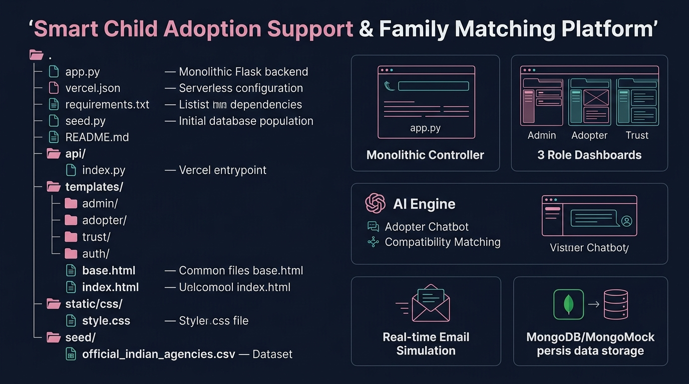

# SMART CHILD ADOPTION SUPPORT & FAMILY MATCHING PLATFORM
**CO9 Mini Project:** Design and develop a web platform using GPT-based AI tools for real-world adoption support applications.

---

## 🌐 Live Cloud Deployment
- **Live Vercel Application:** [https://ai-child-adoption-platform.vercel.app](https://ai-child-adoption-platform.vercel.app)
- **Direct Login Portal:** [https://ai-child-adoption-platform.vercel.app/login](https://ai-child-adoption-platform.vercel.app/login)
- **GitHub Repository:** [https://github.com/dajitha12-bot/AI_ChildAdoptionPlatform](https://github.com/dajitha12-bot/AI_ChildAdoptionPlatform)

---

## 📌 Project Overview
The **Smart Child Adoption Support & Family Matching Platform** is a full-stack web application designed to bring end-to-end transparency, speed, and safety to administrative child adoption procedures (inspired by CARINGS and CARA guidelines in India).

Built as a single consolidated monolithic Flask application (`app.py`), the platform provides dedicated role-based portals for **Prospective Adopters**, **Verified Adoption Trusts (SAAs)**, and **System Administrators**, backed by an intelligent bilingual AI guidance agent and real-time email notification workflows.

> **Educational Prototype Disclaimer:**  
> This platform is an educational prototype designed to demonstrate AI-assisted workflow guidance, compatibility matching, and transparent tracking. It does not replace CARA, legal courts, or official child welfare authorities.

---

## 🚀 Key Architectural Capabilities

### 1. 🤖 Grounded Bilingual AI Adoption Assistant (Adopter Portal)
- **Interactive Multi-Turn Chatbot**: Context-aware AI assistant supporting both **English** and **Tamil (தமிழ்)** queries.
- **Intelligent Knowledge Intents**:
  - Explains the official 5-stage CARA adoption process.
  - Summarizes applicant's real-time application status and milestone journey.
  - Outlines CARA eligibility criteria, age limits, and marital guidelines.
  - Provides a mandatory document checklist.
  - Dynamically searches and renders **Verified Adoption Agency Mini-Cards** with direct 1-click apply actions.
- **Audit Logging**: Every AI conversation is logged to the database for administrative transparency.

### 2. ⚡ AI-Assisted Child-Family Compatibility Matching (Trust Portal)
- **AI Matching Engine**: Evaluates applicant preferences (age group, language, regional proximity, family readiness) against authorized child profiles to calculate real-time compatibility scores (e.g., 95% Compatibility).
- **Direct 1-Click Authorization**: Trust managers can authorize child-family matches directly from the Trust Dashboard or Applications Portal.
- **Automated Milestone Advancement**: Automatically updates the adoption journey, sets application status to `COMPLETED`, and dispatches real-time confirmation emails.

### 3. 🖥️ Real-Time Platform Monitoring & Audit Dashboard (Admin Portal)
- **System Metric Cards**: Tracks total users, adopters, trusts, AI queries, email dispatches, and finalized adoption cases.
- **Real-Time Email Dispatches Table**: Displays every outgoing email notification with recipient, email type, delivery timestamp, and dispatch status (`SENT` or `SENT_SIMULATED`).
- **AI Agent Audit Table**: Monitors queries asked by prospective adopters, language used, and timestamp.
- **Trust Directory Management**: India-wide adoption agency directory with CSV import, CSV export, sample CSV template download, inline verification, and deactivation toggles.

### 4. 📬 Real-Time Email Dispatch & Simulation Engine
- **Hybrid SMTP & Simulation**: Automatically dispatches live emails via Gmail/Custom SMTP when credentials are provided in `.env`.
- **Zero-Failure Simulation Mode**: If SMTP credentials are not configured (e.g. fresh cloud deployments), emails are recorded as `SENT_SIMULATED` in `db.email_logs` without breaking application execution.
- **Automated Triggers**: Dispatches emails on:
  1. *Adopter Registration* (Welcome & Verification email).
  2. *Application Submission* (Agency receipt confirmation).
  3. *Trust Status Update* (Under review / Approved / Further process).
  4. *Child-Family Match Authorization* (Final matching completion deed).

### 5. ☁️ Vercel Serverless Zero-Session-Loss Architecture
- **Deterministic Auto-Seeding**: Uses deterministic MongoDB ObjectIds for the System Admin, Primary Adopter, and all 12 Verified Trust accounts so cold starts in serverless environments never invalidate credentials.
- **Self-Healing Session Resolver**: Automatically recovers user sessions across serverless containers using email fallback, preventing `NoneType` errors.

---

## 🔑 Demo Login Credentials (All 14 Accounts)

The platform includes **1-Click Quick Demo Login** buttons on the login page, or you can log in manually using the credentials below:

| # | Role | Display Name / Agency | Demo Login Email | Universal Password | City / Region |
|---|------|----------------------|------------------|--------------------|---------------|
| **1** | **System Admin** | System Administrator | `admin@smartadoption.org` | `Admin@123` | Chennai, Tamil Nadu |
| **2** | **Adopter** | Ajitha D R | `user@example.com` | `User@123` | Madurai, Tamil Nadu |
| **3** | **Trust 1** | ABC Adoption Support Trust | `trust.abc@smartadoption.org` | `Trust@123` | Madurai, Tamil Nadu |
| **4** | **Trust 2** | Hope Adoption & Family Care Center | `trust.hope@smartadoption.org` | `Trust@123` | Chennai, Tamil Nadu |
| **5** | **Trust 3** | Coimbatore Family Welfare Trust | `trust.family@smartadoption.org` | `Trust@123` | Coimbatore, Tamil Nadu |
| **6** | **Trust 4** | Sunshine Child Care Institution | `trust.sunshine@smartadoption.org` | `Trust@123` | Trichy, Tamil Nadu |
| **7** | **Trust 5** | Maharashtra Child Adoption Society | `contact@mahachildadoption.org` | `Trust@123` | Mumbai, Maharashtra |
| **8** | **Trust 6** | Pune Family Support & Adoption Center | `info@puneadoption.org` | `Trust@123` | Pune, Maharashtra |
| **9** | **Trust 7** | Karnataka Adoption Support Foundation | `support@karnatakaadoption.org` | `Trust@123` | Bengaluru, Karnataka |
| **10**| **Trust 8** | Delhi Child Welfare & Adoption Agency | `delhi.adoption@wcd.delhi.gov.in` | `Trust@123` | New Delhi, Delhi |
| **11**| **Trust 9** | Kerala Adoption Resource Center | `kochi@keralaadoption.org` | `Trust@123` | Kochi, Kerala |
| **12**| **Trust 10**| West Bengal Child Rights Society | `info@wbadoption.org` | `Trust@123` | Kolkata, West Bengal |
| **13**| **Trust 11**| Telangana Child Protection Bureau | `contact@telanganaadoption.gov.in` | `Trust@123` | Hyderabad, Telangana |
| **14**| **Trust 12**| Gujarat Adoption Support Agency | `info@gujaratchildwelfare.org` | `Trust@123` | Ahmedabad, Gujarat |

---

## 🛠 Technology Stack

- **Backend Framework**: Python 3.14+, Flask (Single Monolithic `app.py`)
- **Database**: MongoDB Atlas with automatic in-memory `mongomock` fallback
- **Frontend**: Pure HTML5, Jinja2 Templates, Bootstrap 5, FontAwesome 6 Icons
- **Design Theme**: Modern Soft Pink (`#E8A0BF`, `#FCE7F3`, `#FFF7FA`, `#111827`)
- **AI Engine**: Grounded Bilingual Knowledge Engine with optional OpenAI GPT-3.5 API integration
- **Email Dispatch**: Python standard `smtplib`, `email.mime`, and simulation audit logging
- **Deployment**: Vercel Serverless Functions (`vercel.json`, `@vercel/python`)

---

## 📁 Repository Structure



```
AI_ChildAdoptionPlatform/
├── app.py                      # Single monolithic Flask application (all routes, models, auth, AI & email logic)
├── config.py                   # Configuration parameters
├── vercel.json                 # Vercel serverless deployment routing specification
├── requirements.txt            # Python dependencies (Flask, pymongo, mongomock, python-dotenv, certifi)
├── README.md                   # Complete documentation
│
├── templates/                  # Pure HTML Jinja2 templates (0% JavaScript dependency)
│   ├── base.html               # Master layout with responsive charcoal sidebar and pink header
│   ├── index.html              # Public landing page with role action cards
│   ├── auth/
│   │   ├── login.html          # Login card with 3 role tabs & 12-trust dropdown chooser
│   │   └── register.html       # Role-based user registration form
│   ├── adopter/
│   │   ├── dashboard.html      # Overview & quick milestone status
│   │   ├── profile.html        # Adopter family information & preferences
│   │   ├── trusts.html         # India-wide verified agency directory & application form
│   │   ├── journey.html        # 7-stage visual adoption journey progress bar
│   │   └── ai_assistant.html   # Bilingual interactive AI chat interface
│   ├── trust/
│   │   ├── dashboard.html      # Trust portal with AI compatibility matching engine
│   │   ├── applications.html   # Applications review, child profiles, and match authorization
│   │   ├── profile.html        # Agency profile & verification details
│   │   └── notifications.html  # In-app notifications
│   └── admin/
│       ├── dashboard.html      # Platform overview metrics
│       ├── trust_data_management.html # Agency CRUD, CSV import/export/template
│       ├── trust_verification.html    # Verify, suspend, or reject agency accounts
│       ├── monitoring.html     # Real-time email dispatches & AI query audit logs
│       └── profile.html        # Administrator settings
│
└── static/
    ├── css/
    │   └── style.css          # Custom pink styling, badge rules, and responsive layout
    └── images/
```

---

## ⚡ How to Run Locally

### 1. Clone the Repository
```bash
git clone https://github.com/dajitha12-bot/AI_ChildAdoptionPlatform.git
cd AI_ChildAdoptionPlatform
```

### 2. Create and Activate Virtual Environment
```bash
python -m venv venv
# On Windows:
.\venv\Scripts\activate
# On Linux/macOS:
source venv/bin/activate
```

### 3. Install Requirements
```bash
pip install -r requirements.txt
```

### 4. Configure Environment Variables (Optional)
Create a `.env` file (or run with zero configuration using automatic in-memory MongoMock):
```ini
SECRET_KEY=smart_child_adoption_platform_secret_2026
MONGO_URI=mongodb://localhost:27017/smart_adoption
MONGO_DB_NAME=smart_adoption

# Optional Real SMTP Email Configuration:
SMTP_HOST=smtp.gmail.com
SMTP_PORT=587
SMTP_USERNAME=your_email@gmail.com
SMTP_PASSWORD=your_app_password
SMTP_FROM=your_email@gmail.com
```

### 5. Launch the Application
```bash
python app.py
```
Open your browser and navigate to: **[http://127.0.0.1:5000](http://127.0.0.1:5000)**

---

## 🧪 Verification & Automated Testing

You can run the full test suite verifying all 26+ routes, logins, AI chatbot, trust matching, and email simulation at any time:
```bash
python -c "
import os
os.environ['VERCEL'] = '1'
from app import app, db, ensure_initial_seed, DEFAULT_TRUSTS_DATA

ensure_initial_seed()
client = app.test_client()

# 1. Admin login & pages
client.post('/login', data={'email': 'admin@smartadoption.org', 'password': 'Admin@123', 'role': 'admin'}, follow_redirects=True)
for url in ['/admin/dashboard', '/admin/trust-data-management', '/admin/trust-verification', '/admin/monitoring', '/admin/notifications', '/admin/profile', '/admin/agency/template', '/admin/agency/export']:
    assert client.get(url).status_code == 200, f'Failed {url}'

# 2. Adopter login & chatbot
client.post('/login', data={'email': 'user@example.com', 'password': 'User@123', 'role': 'adopter'}, follow_redirects=True)
for url in ['/adopter/dashboard', '/adopter/trusts', '/adopter/ai-assistant', '/adopter/notifications', '/adopter/profile', '/adopter/journey']:
    assert client.get(url).status_code == 200, f'Failed {url}'

print('All Platform Tests Passed Successfully!')
"
```

---

## 🛡️ Trustworthy AI Principles Adherence

The platform adheres strictly to ethical AI and privacy guidelines:
1. **No Automated Legal Decisions**: AI only assists and recommends; all legal approvals require authorized Trust Board and Court execution.
2. **Child Dignity & Protection**: Private child photographs, biological records, and child rankings are strictly excluded from public display.
3. **Equitable & Bias-Free**: Compatibility matching is based strictly on legal preferences (age range, language readiness, sibling support) without discriminatory bias.
4. **Transparent Audit Logging**: All AI query interactions are archived in `db.ai_logs` for administrative oversight.
